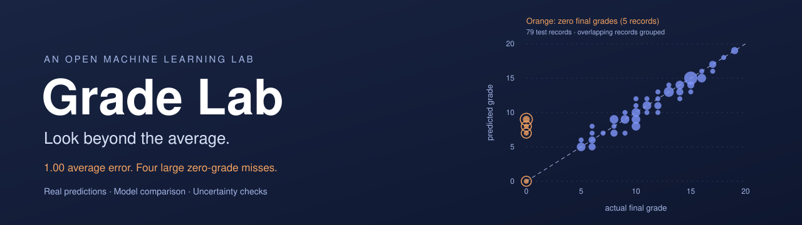
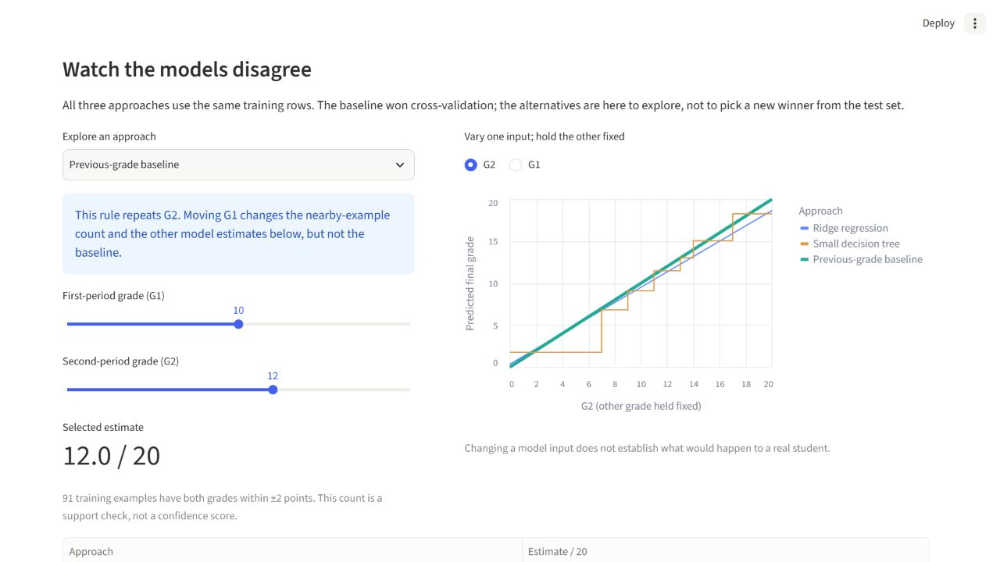
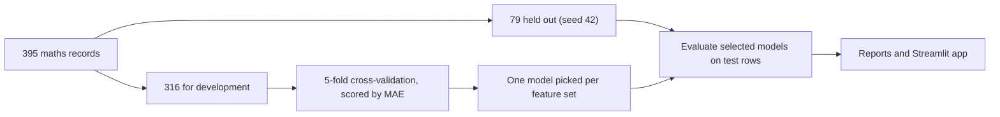

<div align="center">



<br>

[](LICENSE)

[](https://grade-lab-ran-nope.streamlit.app/)
[](https://github.com/ran-nope/grade-lab/actions/workflows/tests.yml)


</div>

Grade Lab predicts final mathematics grades for 395 secondary-school students, then asks a more useful question: how much of that prediction comes from simply knowing the grades they already had? On the original split, repeating the second-period grade beat the ridge and tree candidates in training cross-validation. The app lets you compare their predictions and see where the winning rule fails.

## The result in two tables

Test MAE is the average miss in grade points on a 0–20 scale, measured on 79 students the models never saw.

| Approach | Test MAE | 95% bootstrap interval |
|---|---:|---:|
| Repeat the second-period grade (G2) | 1.00 | 0.63–1.43 |
| Ridge on study time, past failures and travel time | 3.50 | 2.93–4.09 |

These compare different input sets. The intervals resample test rows with the fitted models held fixed; they are not uncertainty ranges for an individual student.

A good average can hide bad misses. Split the held-out students by whether their final grade was zero:

| Group | Students | MAE |
|---|---|---|
| Final grade of zero | 5 | 6.60 |
| Everyone else | 74 | 0.62 |

One of the five zero-grade cases was predicted correctly. Four were missed, including two at the same plotted point, (0, 9). The data does not establish why those grades were zero. All cases stay in the analysis.

<div align="center">

</div>


## A tour of the app

The Streamlit app has three tabs and native light/dark themes. [Dark-mode preview](assets/app-dark.jpg).

| Tab | What you do there |
|---|---|
| 01 Prediction studio | Choose baseline, ridge, or tree; compare all estimates; vary G1 or G2 in the scenario curves. The baseline clearly explains why G1 does not change its estimate. Nearby-example counts indicate data support, not confidence. |
| 02 Evidence room | Inspect three feature experiments, the equality line and highlighted zero-grade cases, bootstrap intervals, and all ten additional splits. |
| 03 Learn the project | Six short steps that walk through the whole method, from the question to the limits. |

## Run it

Tested on Python 3.12.

```
python -m venv .venv
```

Activate the environment. On Windows PowerShell:

```
.venv\Scripts\Activate.ps1
```

On macOS or Linux:

```
source .venv/bin/activate
```

Then:

```
pip install -r requirements.txt
python grade_lab.py
python robustness.py
streamlit run app.py
```

If PowerShell blocks activation, skip it and call the interpreter directly: `.venv\Scripts\python.exe -m pip install -r requirements.txt`, then `.venv\Scripts\python.exe -m streamlit run app.py`. No policy changes are needed.

The mathematics CSV is bundled with attribution. If the file is missing, the training script downloads it from UCI. There are no accounts, keys or uploads.

## How the experiment works



Only the 395 mathematics records are used. The Portuguese-language file is left out because some students appear in both. Scaling happens inside each regression pipeline, so validation folds never influence preprocessing. The default baseline is the original selected grade-based approach. Studio alternatives are fitted on the same training rows and are shown for exploration; selecting one does not change the reported experiment winner.

<details>
<summary>Model settings and what the metrics mean</summary>

<br>

Ridge uses alpha=10. The decision tree uses depth 3 and at least 15 samples per leaf. These are fixed, modest choices and were not tuned against the test set. Predictions are shown raw, without clipping to 0–20.

MAE is measured in grade points. It is not an accuracy percentage and it is not an uncertainty interval for any one student. The cross-validation standard deviation describes variation between folds and is not a confidence interval.

</details>

Full numbers: [original results](reports/RESULTS.md), [training CV scores](reports/cross_validation.csv), [held-out predictions](reports/held_out_predictions.csv), and [experiment chart](reports/experiment.png).

## How stable is the result?

The original split stays unchanged. Two supplementary checks make its limits clearer:

- **Test-row uncertainty:** 10,000 paired bootstrap resamples, seed 2026. The context-minus-grades MAE gap is reported with its paired interval in [ROBUSTNESS.md](reports/ROBUSTNESS.md). This assumes IID rows and omits retraining, selection, school clustering, and distribution shifts.
- **Split sensitivity:** ten fixed seeds, each rerunning training-only model selection. Grade-based MAE ranges from **0.66 to 1.23**; context-only MAE ranges from **2.97 to 3.53**. Every run is published in [split_sensitivity.csv](reports/split_sensitivity.csv).

The extra checks were added after reviewing the first result. The splits overlap, so their range is descriptive, not a confidence interval or ten independent replications. None of these results changes the original selected approach.

## Limits

- The data covers two Portuguese schools in one period. A random split estimates performance inside that sample, not at other schools or in later years.
- G1 and G2 are earlier grading-period scores, so predictions come after the second period. This is not an early-warning system.
- Study-context variables come from school reports and questionnaires; their collection timing is not established for this prediction setting. Treat the context experiments as associations.
- End-of-course absences and sensitive demographic fields are excluded. Leaving them out does not make the model fair.
- Moving a slider changes a model input. It says nothing about what would happen to a real student.
- The nearby-example count is a simple support check and not a statistical uncertainty estimate.
- Do not use this for admissions, grading, ranking students or deciding who gets help.

## Learn from it and extend it

Start with [LEARNING_GUIDE.md](LEARNING_GUIDE.md), then open [student_performance.ipynb](student_performance.ipynb). The notebook has saved outputs, so you can read it without installing anything.

Experiments worth trying:

1. Add a median baseline and work out why MAE can favor it over a mean baseline.
2. Define a protocol for testing transfer between the two schools.
3. Add prediction intervals from a separate calibration split and measure how often they cover the truth.
4. Explain how the ten published splits change the zero-grade case count and the overall error, without choosing a favorite seed.

If you tune anything against this report's test results, stop calling that test set untouched.

## Verify

```
pip install -r requirements-dev.txt
python -m pytest -q
```

The tests check split isolation, target exclusion, held-out-label invariance for every studio model, known-answer paired bootstrap results, and model-selector/slider interactions. GitHub Actions runs them on every push and pull request. `requirements-lock.txt` records the exact environment behind the supplied outputs, and the smaller requirements files allow compatible versions.

## Project layout

```
app.py                       Streamlit app
grade_lab.py                 Download, validate, train, evaluate, chart
robustness.py                Paired bootstrap and ten fixed split checks
student_performance.ipynb    Executed walkthrough for beginners
LEARNING_GUIDE.md            Concepts, reading order, practice prompts
data/                        Original mathematics CSV with attribution
reports/                     Metrics, predictions, uncertainty, provenance
assets/                      Data-derived banner, social image, app screenshot
scripts/build_assets.py      Rebuild the banner and social image from results
tests/                       Leakage checks and app tests
```

## How this was built

This project was developed with AI assistance for the implementation, documentation, and tests. The project owner supplied the review and visual direction for this revision. The update adds model comparisons, checks the uncertainty, corrects the banner using actual predictions, and documents what the data cannot establish.

## Data and license

Dataset: Cortez, P. (2008). Student Performance. UCI Machine Learning Repository. https://doi.org/10.24432/C5TG7T, licensed [CC BY 4.0](https://creativecommons.org/licenses/by/4.0/). The mathematics CSV is redistributed unchanged, and the aggregates and charts are derived from it. Details are in [data/README.md](data/README.md).

Code is released under the [MIT license](LICENSE).
