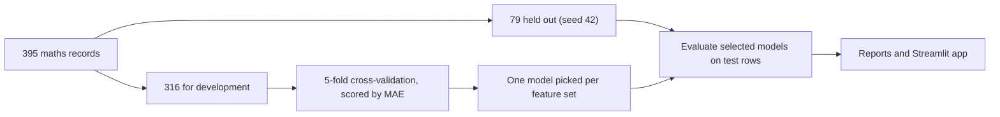

<div align="center">


<br>

[](LICENSE)

[](https://grade-lab-ran-nope.streamlit.app/)
[](https://github.com/ran-nope/grade-lab/actions/workflows/tests.yml)


</div>

Grade Lab predicts final mathematics grades for 395 secondary-school students, then asks a more useful question: how much of that prediction comes from simply knowing the grades they already had? On the original split, repeating the second-period grade beat the ridge and tree candidates in training cross-validation. The app lets you compare their predictions and see where the winning rule fails.

## The result in two tables

Test MAE is the average miss in grade points on a 0–20 scale, measured on 79 students the models never saw.

| Approach | Test MAE | 95% bootstrap interval |
|---|---:|---:|
| Repeat the second-period grade (G2) | 1.00 | 0.63–1.43 |
| Ridge on study time, past failures and travel time | 3.50 | 2.93–4.09 |

These approaches use different inputs. The intervals describe average error across resamples of the test rows, with the fitted models held fixed. They cannot give a range for an individual student's grade.

A good average can hide bad misses. Split the held-out students by whether their final grade was zero:

| Group | Students | MAE |
|---|---|---|
| Final grade of zero | 5 | 6.60 |
| Everyone else | 74 | 0.62 |

One of the five zero-grade cases was predicted correctly. Four were missed, including two at the same plotted point, (0, 9). The data does not establish why those grades were zero. All cases stay in the analysis. In the development split, all 12 students with a second-period grade of zero finished with zero, and 21 of the 33 students who finished with zero had a nonzero second-period grade ([development split report](reports/ZERO_GRADES.md)).

<div align="center">

</div>


## A tour of the app

The Streamlit app has three tabs and native light/dark themes. [Dark-mode preview](assets/app-dark.jpg).

| Tab | What you do there |
|---|---|
| 01 Prediction studio | Choose the baseline, ridge, or tree. Compare all estimates and vary G1 or G2 in the scenario curves. When the baseline is selected, the app explains why G1 does not change its estimate. The nearby-example count shows how many development records have similar grades. |
| 02 Evidence room | Inspect three feature experiments, the equality line and highlighted zero-grade cases, bootstrap intervals, and all ten additional splits. |
| 03 Learn the project | Six short steps that walk through the whole method, from the question to the limits. |

## Run it

Tested on Python 3.12.

```
python -m venv .venv
```

Activate the environment. On Windows PowerShell:

```
.venv\Scripts\Activate.ps1
```

On macOS or Linux:

```
source .venv/bin/activate
```

Then:

```
pip install -r requirements.txt
python grade_lab.py
python robustness.py
streamlit run app.py
```

If PowerShell blocks activation, skip it and call the interpreter directly: `.venv\Scripts\python.exe -m pip install -r requirements.txt`, then `.venv\Scripts\python.exe -m streamlit run app.py`. No policy changes are needed.

The mathematics CSV is bundled with attribution. If the file is missing, the training script downloads it from UCI. There are no accounts, keys or uploads.

## How the experiment works



The published headline results use 395 mathematics records. The app also offers a separate Portuguese cohort with 649 records. The cohorts are never pooled because some students appear in both. Scaling happens inside each regression pipeline, so validation folds never influence preprocessing. The default baseline is the original selected grade-based approach. Studio alternatives are fitted on the same training rows and are shown for exploration; selecting one does not change the reported experiment winner.

<details>
<summary>Model settings and what the metrics mean</summary>

<br>

Ridge uses alpha=10. The decision tree uses depth 3 and at least 15 samples per leaf. These are fixed, modest choices and were not tuned against the test set. Predictions are shown raw, without clipping to 0–20.

MAE is measured in grade points. The cross-validation standard deviation describes variation between folds.

</details>

Full numbers: [original results](reports/RESULTS.md), [training CV scores](reports/cross_validation.csv), [held-out predictions](reports/held_out_predictions.csv), and [experiment chart](reports/experiment.png).

## How stable is the result?

The bootstrap uses 10,000 paired resamples with seed 2026. It assumes independent test rows from the same distribution and omits retraining, model selection, school clustering, and distribution shifts. The report gives the paired interval for the difference between context-only and earlier-grades MAE. [Bootstrap report](reports/ROBUSTNESS.md)

Each of the ten fixed seeds repeats model selection on that split's development rows. Grade-based MAE ranges from 0.66 to 1.23, and context-only MAE ranges from 2.97 to 3.53. The splits overlap, so the ranges describe variation across related runs. [All split results](reports/split_sensitivity.csv)

### Exploratory benchmarks

The expanded context uses study time, failures, travel time, absences, parental education, and five categorical fields. The grades-plus-context version adds G1, G2, and their difference (G2 minus G1). Each model fits scaling and categorical encoding inside the training fold.

The hurdle model returns zero when G2 is zero. For other rows, a class-weighted logistic model estimates zero-grade risk and ridge estimates the grade using only positive final grades during training. The hard mode uses a fixed 0.50 cutoff. The expected mode weights the positive-grade estimate by one minus the logistic score. Class weighting means the score should not be read as a calibrated probability.

On the original 79 mathematics test records:

| Inputs and model | Overall MAE | Zero-grade MAE (5) | Nonzero-grade MAE (74) |
|---|---:|---:|---:|
| Expanded context, ridge | 3.66 | 9.90 | 3.24 |
| Expanded context, tree | 3.38 | 7.98 | 3.07 |
| Grades and expanded context, ridge | 1.35 | 6.40 | 1.01 |
| Grades and expanded context, tree | 1.31 | 3.97 | 1.13 |
| Repeat G2 | 1.00 | 6.60 | 0.62 |
| Hurdle, hard | 1.34 | 1.82 | 1.30 |
| Hurdle, expected | 1.68 | 2.93 | 1.59 |

Both hurdle modes lower the error on the five zero-grade records and raise overall error. The expanded comparisons are retrospective because the timing of the absences field is unverified. The original training-only model selection is unchanged. [Full benchmark](reports/expanded_benchmarks.csv) · [Five-seed benchmark](reports/expanded_seed_sweep.csv)

### Conformal intervals

The shaded band uses a fixed studio model fitted on 75% of the development records. The other 25% supplies absolute residuals for the finite-sample calibration cutoff. The dashed curve shows the fit used for the band, and the solid curves use the full development split. On the mathematics test set, nominal 90% intervals covered 83.5% for the G2 baseline, 87.3% for ridge, and 79.7% for the tree. Coverage applies across comparable records under exchangeability. The app reports the observed fraction separately from the bootstrap interval for MAE. [Coverage report](reports/conformal_coverage.csv)

## Limits

- The data covers two Portuguese schools in one period. A random split estimates performance inside that sample, not at other schools or in later years.
- G1 and G2 are earlier grading-period scores, so predictions come after the second period. This is not an early-warning system.
- Study-context variables come from school reports and questionnaires; their collection timing is not established for this prediction setting. Treat the context experiments as associations.
- The original experiments exclude absences and demographic fields. The expanded comparisons include absences and parental education.
- Moving a slider changes a model input. It says nothing about what would happen to a real student.
- The nearby-example count is a simple support check and not a statistical uncertainty estimate.
- Do not use this for admissions, grading, ranking students or deciding who gets help.

## Learn from it and extend it

Start with [LEARNING_GUIDE.md](LEARNING_GUIDE.md), then open [student_performance.ipynb](student_performance.ipynb). The notebook has saved outputs, so you can read it without installing anything.

Experiments worth trying:

1. Add a median baseline and work out why MAE can favor it over a mean baseline.
2. Define a protocol for testing transfer between the two schools.
3. Add prediction intervals from a separate calibration split and measure how often they cover the truth.
4. Explain how the ten published splits change the zero-grade case count and the overall error, without choosing a favorite seed.

If you tune anything against this report's test results, stop calling that test set untouched.

## Verify

```
pip install -r requirements-dev.txt
python -m pytest -q
```

The tests check split isolation, target exclusion, held-out-label invariance for every studio model, known-answer paired bootstrap results, and model-selector/slider interactions. GitHub Actions runs them on every push and pull request. `requirements-lock.txt` records the exact environment behind the supplied outputs, and the smaller requirements files allow compatible versions.

## Project layout

```
app.py                       Streamlit app
grade_lab.py                 Download, validate, train, evaluate, chart
robustness.py                Paired bootstrap and ten fixed split checks
student_performance.ipynb    Executed walkthrough for beginners
LEARNING_GUIDE.md            Concepts, reading order, practice prompts
data/                        Original mathematics CSV with attribution
reports/                     Metrics, predictions, uncertainty, provenance
assets/                      Data-derived banner, social image, app screenshot
scripts/build_assets.py      Rebuild the banner and social image from results
tests/                       Leakage checks and app tests
```

## How this was built

<!-- What did you review or question? What is one thing you got wrong or changed your mind about? What is one thing you now understand better? -->

## Data and license

Dataset: Cortez, P. (2008). Student Performance. UCI Machine Learning Repository. https://doi.org/10.24432/C5TG7T, licensed [CC BY 4.0](https://creativecommons.org/licenses/by/4.0/). The mathematics CSV is redistributed unchanged, and the aggregates and charts are derived from it. Details are in [data/README.md](data/README.md).

Code is released under the [MIT license](LICENSE).
