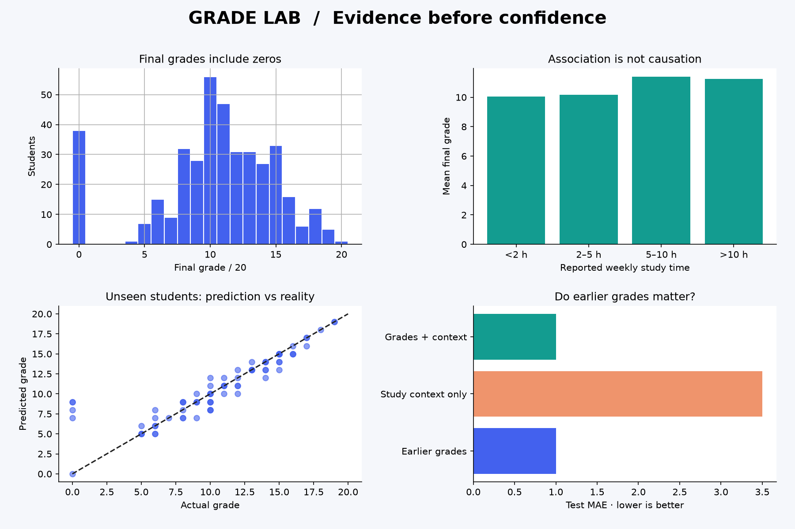

# Grade Lab 🧪

**Grades are signals. Not destinies.**

A beginner-friendly machine learning lab that predicts final mathematics grades, compares useful baselines, and asks a more interesting question: **how much of the prediction comes from simply knowing earlier grades?**



## What makes this different

- **Prediction studio:** change two earlier grades and explore the model's response. A nearby-example count flags poorly supported inputs.
- **Information experiment:** compare earlier grades, study context, and both together using identical splits.
- **Evidence room:** inspect model selection, held-out results, and errors on zero versus nonzero final grades.
- **Strong baseline:** a model must compete with simply repeating the second-period grade.
- **Learning trail:** an executed notebook and plain-language walkthrough explain the whole process.

This is a completed educational prototype built with AI assistance. Its value as a learning project comes from reading, reproducing, and extending it—not claiming independent authorship of generated code.

## Run locally

Use Python 3.12. From this folder:

```bash
python -m venv .venv
```

Activate on Windows PowerShell:

```powershell
.venv\Scripts\Activate.ps1
```

Or on macOS / Linux:

```bash
source .venv/bin/activate
```

Then:

```bash
pip install -r requirements.txt
python grade_lab.py
streamlit run app.py
```

If PowerShell blocks activation, use `.venv\Scripts\python.exe -m pip install -r requirements.txt` and `.venv\Scripts\python.exe -m streamlit run app.py` instead. No policy changes are needed.

The public mathematics CSV is bundled with attribution. If it is missing, the training script downloads it from UCI. No accounts, keys, or personal student uploads are needed.

## Results and methodology

**Main finding:** the previous-grade baseline won training cross-validation for both grade-based experiments. On 79 held-out records, its MAE was **1.00 point**, versus **3.50 points** for the selected context-only ridge model. Error was much larger on the five zero-final-grade cases (**6.60 points**) than on the other 74 cases (**0.62 points**). A good overall average can hide serious misses.

See [the measured results](reports/RESULTS.md), [all training CV scores](reports/cross_validation.csv), and [held-out predictions](reports/held_out_predictions.csv).

1. Use only the 395 mathematics records. Do not mix the Portuguese subject data; students can overlap between subjects.
2. Reserve 79 records for testing with seed 42; use the remaining 316 for development.
3. Within training, compare fixed candidate models with shuffled five-fold cross-validation, scored by MAE.
4. Fit scaling inside each regression pipeline so validation folds cannot influence preprocessing.
5. Select one model per feature set using training CV scores, then evaluate on the untouched test set.
6. Keep the evaluated training-only model in the demo. Scenario estimates and reported metrics refer to the same fitted model.

Ridge uses alpha=10. The tree uses depth=3 and at least 15 samples per leaf. These are fixed modest-complexity choices, not a test-set hyperparameter search. Raw predictions are evaluated and displayed without clipping. MAE is measured in grade points; it is neither accuracy percentage nor an individual uncertainty interval. CV standard deviation is descriptive fold variation, not a confidence interval.

## Honest limitations

- Historical records from two Portuguese schools cannot establish performance at other schools, in other countries, or today. The random split estimates within-sample generalization, not future-time or cross-school generalization.
- G1 and G2 are earlier grading-period scores. This is a prediction after the second period, not an early-term warning system.
- Context inputs are study time, past failures, and travel time. Their questionnaire measurement timing is not verified; context experiments are retrospective associations.
- End-of-course absences and sensitive demographic fields are excluded. Excluding these fields does not establish fairness.
- Zero final grades are retained. We do not infer why those grades occurred.
- Changing a slider changes a model input, not the world. Scenario curves are not causal advice.
- Nearby-example counts are a simple support check, not a statistical uncertainty estimate.
- Do not use this demo for admissions, grading, ranking students, or allocating educational opportunities.

## Learn and extend

Start with [LEARNING_GUIDE.md](LEARNING_GUIDE.md), then open [student_performance.ipynb](student_performance.ipynb). Read the notebook's saved outputs without installing anything, or execute it from the repository root.

Useful next experiments:

1. Add a median baseline and explain why MAE can favor it over a mean baseline.
2. Evaluate transfer between schools using a new explicitly defined evaluation protocol.
3. Add prediction intervals using a separate calibration split and measure their held-out coverage.
4. Investigate how results vary over prespecified random seeds without choosing the best seed.

Do not tune against this report's test results and continue calling the same test set untouched.

## Verify

```bash
pip install -r requirements-dev.txt
python -m pytest -q
```

Tests cover split isolation, target exclusion, invariance to held-out-label changes, valid predictions, and app interactions. GitHub Actions runs the checks on pushes and pull requests. `requirements-lock.txt` records the exact local environment used for the supplied outputs; the small requirements files allow compatible installations.

## Files

```text
app.py                       Interactive Streamlit app
grade_lab.py                 Download, validate, train, evaluate, chart
student_performance.ipynb    Executed beginner walkthrough
data/                       Attributed original mathematics CSV
reports/                    Real metrics, predictions, provenance, chart
tests/                      Data leakage and app checks
LEARNING_GUIDE.md            Concepts, reading order, practice prompts
```

## Attribution and license

Dataset: Cortez, P. (2008). *Student Performance*. UCI Machine Learning Repository. https://doi.org/10.24432/C5TG7T. Data licensed under [CC BY 4.0](https://creativecommons.org/licenses/by/4.0/). The original mathematics CSV is redistributed unchanged; aggregates and charts are derived from it. See [data/README.md](data/README.md).

Project code: MIT. AI assistance was used for implementation, documentation, and testing. No performance claims are fabricated.
